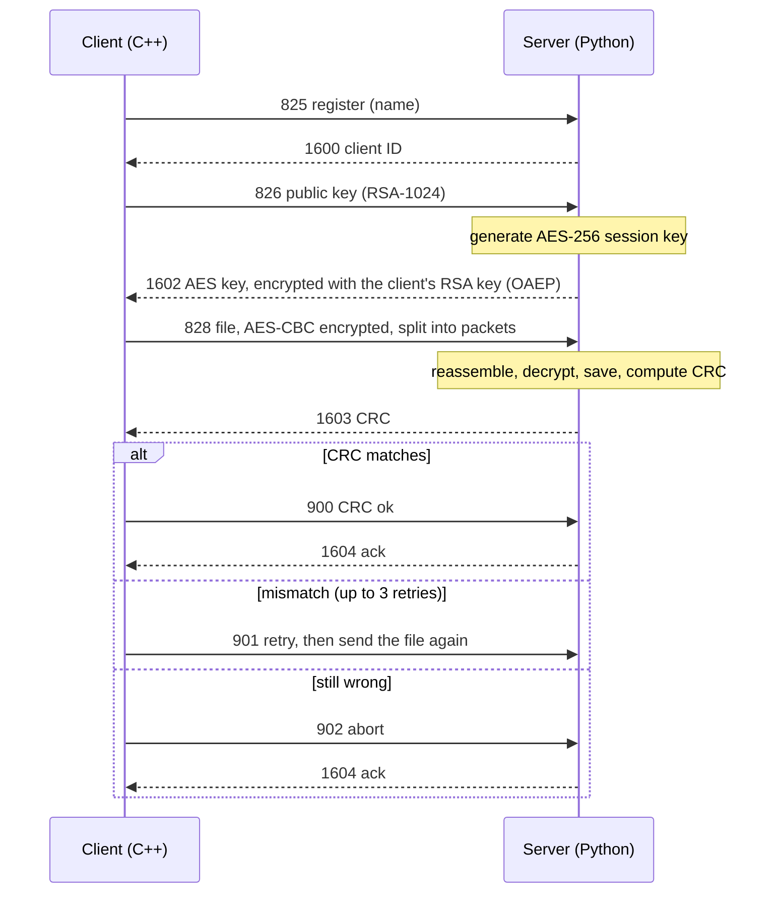

# Secure File Transfer

**An encrypted client-server file transfer over a custom binary protocol, plus a security review of my own implementation.**

This was the final project of *Defensive Systems Programming* (course 20937, the Open University of Israel). A **C++ client** registers with a **Python server**, exchanges keys, and uploads a file encrypted end to end. The server decrypts the file, and both sides verify its integrity with a checksum before the transfer is accepted.

Writing the code was half the assignment. The other half was attacking it: [`חולשות-אבטחה-מטלה-06.pdf`](חולשות-אבטחה-מטלה-06.pdf) (in Hebrew) documents nine vulnerabilities in the protocol and in the server, each with an attack scenario, a DREAD score and a fix.

---

## The protocol

A binary protocol over TCP. Every field is fixed-width, unsigned and little-endian. Requests carry a 23-byte header (client ID, version, code, payload size), and responses carry a 7-byte header.



A returning client skips registration and key exchange. It sends **827 reconnect**, and the server answers with a fresh AES key wrapped in the public key it already has on file, or rejects the client if it doesn't recognize it.

| Request | | Response | |
|---|---|---|---|
| 825 | register | 1600 / 1601 | registered / name taken |
| 826 | send public key | 1602 | AES key (RSA-wrapped) |
| 827 | reconnect | 1605 / 1606 | new AES key / rejected |
| 828 | send file (packet) | 1603 | file received + CRC |
| 900 / 902 | CRC ok / abort | 1604 | ack |
| 901 | CRC wrong, retrying | | no reply: the client just sends the file again |
| | | 1607 | general error |

## Implementation

**Server (Python)**
- **One thread per client, behind a semaphore.** The server accepts at most 100 concurrent connections and refuses the rest instead of collapsing under them.
- **A dispatcher routes each request code to its own servlet** (`register`, `public_key`, `send_file`, `crc_ok`…), so every request type is a small, self-contained handler.
- **SQLite storage** for clients and files, behind a repository layer that serializes writes across threads.
- **The CRC is computed exactly like the Linux `cksum` command,** not with `binascii.crc32`, so it matches the C++ client bit for bit.

**Client (C++20)**
- **Boost.Asio for TCP, Crypto++ for RSA-OAEP and AES-CBC.**
- **Layered:** `transport/` (socket), `protocol/` (request and response serialization), `crypto/` (thin wrappers), `client/` (the flow and its retries).
- **Builds with CMake on Linux** or with the included Visual Studio solution on Windows.

**Test client (Python).** [`sim_client.py`](sim_client.py) speaks the protocol from scratch, without importing any server code, and exercises every request and response. It's useful for testing the server without building the C++ client.

## Security review

The highlight of the project. Each weakness is scored with [DREAD](https://en.wikipedia.org/wiki/DREAD_(risk_assessment_model)) (Damage, Reproducibility, Exploitability, Affected users, Discoverability) and classified by **where it lives**:
- **Implementation:** fixable in the server alone. Three of these I fixed.
- **Protocol:** built into the spec the assignment prescribed. Fixing one needs a protocol change, so the review proposes it instead.

| # | Vulnerability | Level | DREAD | Status |
|---|---|---|---|---|
| 1 | Man-in-the-middle during key exchange | protocol | 8.0 | proposed fix |
| 2 | Connection flooding (Slowloris) | implementation | 7.6 | **fixed**: per-client timeout + connection semaphore |
| 3 | Memory exhaustion through the size field | implementation | 7.0 | **fixed**: caps on request size and total transfer size |
| 4 | Impersonation and account takeover | protocol | 6.8 | proposed fix |
| 5 | Information leak from a fixed (zero) IV | protocol | 6.4 | proposed fix |
| 6 | CRC is not a MAC (no tamper protection) | protocol | 6.2 | proposed fix |
| 7 | Secrets stored in plain text on the server | implementation | 6.0 | proposed fix |
| 8 | Path traversal through the file name | implementation | 5.6 | **fixed**: only the base name is used |
| 9 | No replay protection | protocol | 5.0 | proposed fix |

The common thread in the protocol-level findings: the protocol gives the data **confidentiality but not integrity or authenticity**. Nobody authenticates the server's key, a CRC detects accidents but not attackers, and nothing stops a recorded message from being replayed. The fixes the review proposes come down to authenticated encryption (for example AES-GCM), a pinned server key, and per-message nonces.

## Repository layout

```
roni_cpp/                    C++ client
  transport/  protocol/  crypto/  client/
  transfer.json              server address, client name, file to send
  CMakeLists.txt  Client.sln
roni_py/                     Python server
  network/                   socket, thread per client, dispatcher
  servlets/                  one handler per request code
  protocol/                  parsing, crypto, cksum
  storage/                   SQLite + repository
sim_client.py                standalone protocol test client
חולשות-אבטחה-מטלה-06.pdf     security review (Hebrew)
סרטון קצר.mkv                 short demo video
```

## Running it

```bash
# server (listens on the port in roni_py/port.info)
cd roni_py
pip install -r requirements.txt
python main.py

# test client, from another terminal
python sim_client.py 127.0.0.1 1234

# C++ client (needs Crypto++ and Boost)
cd roni_cpp
cmake -B build && cmake --build build
./build/client_app           # reads transfer.json
```
